# ambientCG: Paving Stones materials

**24 assets from [ambientCG](https://ambientcg.com), dedicated to the public domain under [CC0](https://docs.ambientcg.com/license/).** Use them in any game, free or paid, and change them however you like; no credit is needed.

PBR materials as 1K and 2K JPG maps (colour, normal GL and DX, roughness, AO, displacement), one folder per resolution. 878.4 MB in all.

This is a copy kept by [zuujis-cc0](https://github.com/zuujis-cc0) so game makers can take single files from GitHub. It is not made by or affiliated with ambientCG: the originals, often in more formats and higher resolutions, are on [ambientcg.com](https://ambientcg.com). If they help you, consider [supporting ambientCG](https://www.patreon.com/ambientCG).

Every file is listed in [MANIFEST.tsv](MANIFEST.tsv) with its size and SHA-256. More free assets: [the Zuujis collection](https://github.com/zuujis-cc0/free-game-assets#readme).

| | | | |
| :-: | :-: | :-: | :-: |
| <a href="PavingStones094">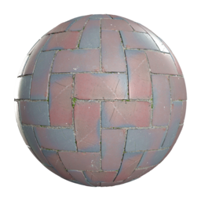</a> <b><a href="PavingStones094">Paving Stones 094</a></b> by ambientCG · <a href="https://ambientcg.com/a/PavingStones094">source</a> | <a href="PavingStones095">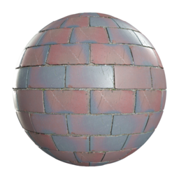</a> <b><a href="PavingStones095">Paving Stones 095</a></b> by ambientCG · <a href="https://ambientcg.com/a/PavingStones095">source</a> | <a href="PavingStones096">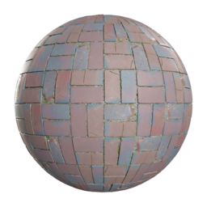</a> <b><a href="PavingStones096">Paving Stones 096</a></b> by ambientCG · <a href="https://ambientcg.com/a/PavingStones096">source</a> | <a href="PavingStones097">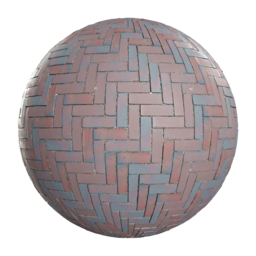</a> <b><a href="PavingStones097">Paving Stones 097</a></b> by ambientCG · <a href="https://ambientcg.com/a/PavingStones097">source</a> |
| <a href="PavingStones098">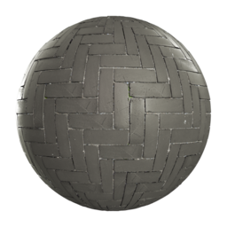</a> <b><a href="PavingStones098">Paving Stones 098</a></b> by ambientCG · <a href="https://ambientcg.com/a/PavingStones098">source</a> | <a href="PavingStones099">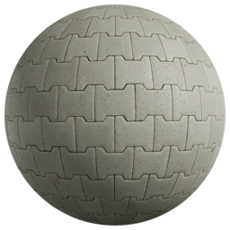</a> <b><a href="PavingStones099">Paving Stones 099</a></b> by ambientCG · <a href="https://ambientcg.com/a/PavingStones099">source</a> | <a href="PavingStones100">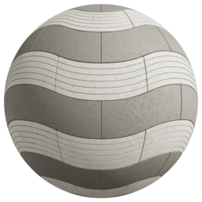</a> <b><a href="PavingStones100">Paving Stones 100</a></b> by ambientCG · <a href="https://ambientcg.com/a/PavingStones100">source</a> | <a href="PavingStones101">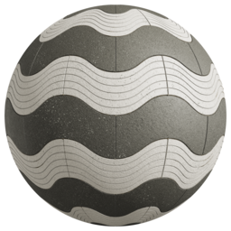</a> <b><a href="PavingStones101">Paving Stones 101</a></b> by ambientCG · <a href="https://ambientcg.com/a/PavingStones101">source</a> |
| <a href="PavingStones102">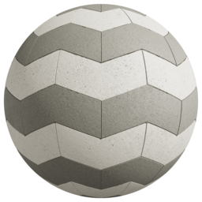</a> <b><a href="PavingStones102">Paving Stones 102</a></b> by ambientCG · <a href="https://ambientcg.com/a/PavingStones102">source</a> | <a href="PavingStones103">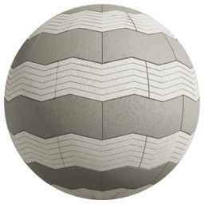</a> <b><a href="PavingStones103">Paving Stones 103</a></b> by ambientCG · <a href="https://ambientcg.com/a/PavingStones103">source</a> | <a href="PavingStones104">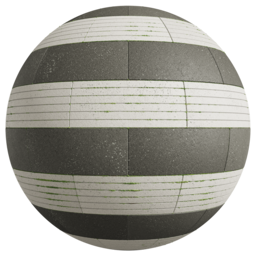</a> <b><a href="PavingStones104">Paving Stones 104</a></b> by ambientCG · <a href="https://ambientcg.com/a/PavingStones104">source</a> | <a href="PavingStones105">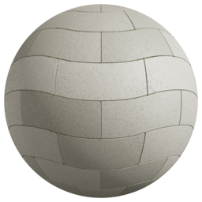</a> <b><a href="PavingStones105">Paving Stones 105</a></b> by ambientCG · <a href="https://ambientcg.com/a/PavingStones105">source</a> |
| <a href="PavingStones106">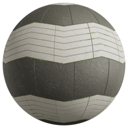</a> <b><a href="PavingStones106">Paving Stones 106</a></b> by ambientCG · <a href="https://ambientcg.com/a/PavingStones106">source</a> | <a href="PavingStones107">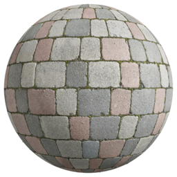</a> <b><a href="PavingStones107">Paving Stones 107</a></b> by ambientCG · <a href="https://ambientcg.com/a/PavingStones107">source</a> | <a href="PavingStones108">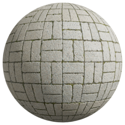</a> <b><a href="PavingStones108">Paving Stones 108</a></b> by ambientCG · <a href="https://ambientcg.com/a/PavingStones108">source</a> | <a href="PavingStones109">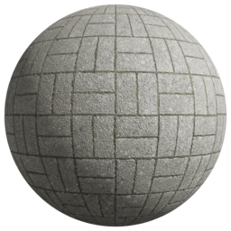</a> <b><a href="PavingStones109">Paving Stones 109</a></b> by ambientCG · <a href="https://ambientcg.com/a/PavingStones109">source</a> |
| <a href="PavingStones110">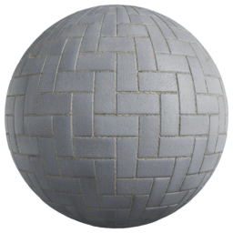</a> <b><a href="PavingStones110">Paving Stones 110</a></b> by ambientCG · <a href="https://ambientcg.com/a/PavingStones110">source</a> | <a href="PavingStones111">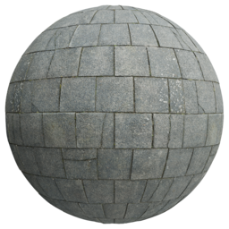</a> <b><a href="PavingStones111">Paving Stones 111</a></b> by ambientCG · <a href="https://ambientcg.com/a/PavingStones111">source</a> | <a href="PavingStones112">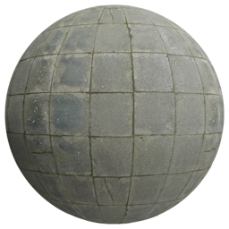</a> <b><a href="PavingStones112">Paving Stones 112</a></b> by ambientCG · <a href="https://ambientcg.com/a/PavingStones112">source</a> | <a href="PavingStones113">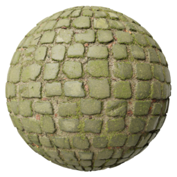</a> <b><a href="PavingStones113">Paving Stones 113</a></b> by ambientCG · <a href="https://ambientcg.com/a/PavingStones113">source</a> |
| <a href="PavingStones114">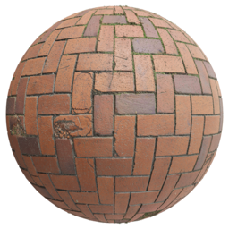</a> <b><a href="PavingStones114">Paving Stones 114</a></b> by ambientCG · <a href="https://ambientcg.com/a/PavingStones114">source</a> | <a href="PavingStones115A">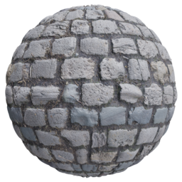</a> <b><a href="PavingStones115A">Paving Stones 115 A</a></b> by ambientCG · <a href="https://ambientcg.com/a/PavingStones115A">source</a> | <a href="PavingStones115B">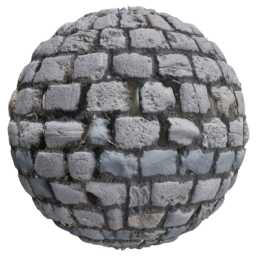</a> <b><a href="PavingStones115B">Paving Stones 115 B</a></b> by ambientCG · <a href="https://ambientcg.com/a/PavingStones115B">source</a> | <a href="PavingStones115C">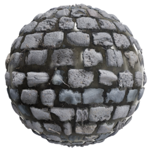</a> <b><a href="PavingStones115C">Paving Stones 115 C</a></b> by ambientCG · <a href="https://ambientcg.com/a/PavingStones115C">source</a> |

---

Kept up to date by this repository's own [update workflow](.github/workflows/update.yml), with code and plan from [cc0-mirror](https://github.com/zuujis-cc0/cc0-mirror). Something wrong? [Open an issue there](https://github.com/zuujis-cc0/cc0-mirror/issues/new) or use the [private report form](https://games.zuujis.com/report).
